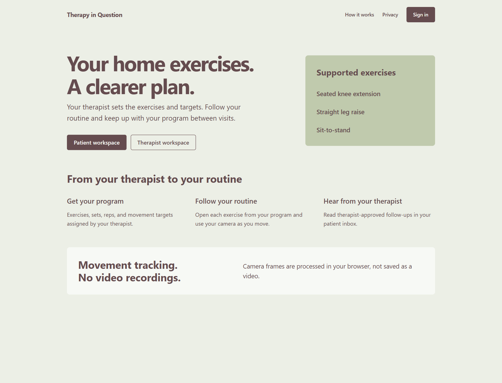
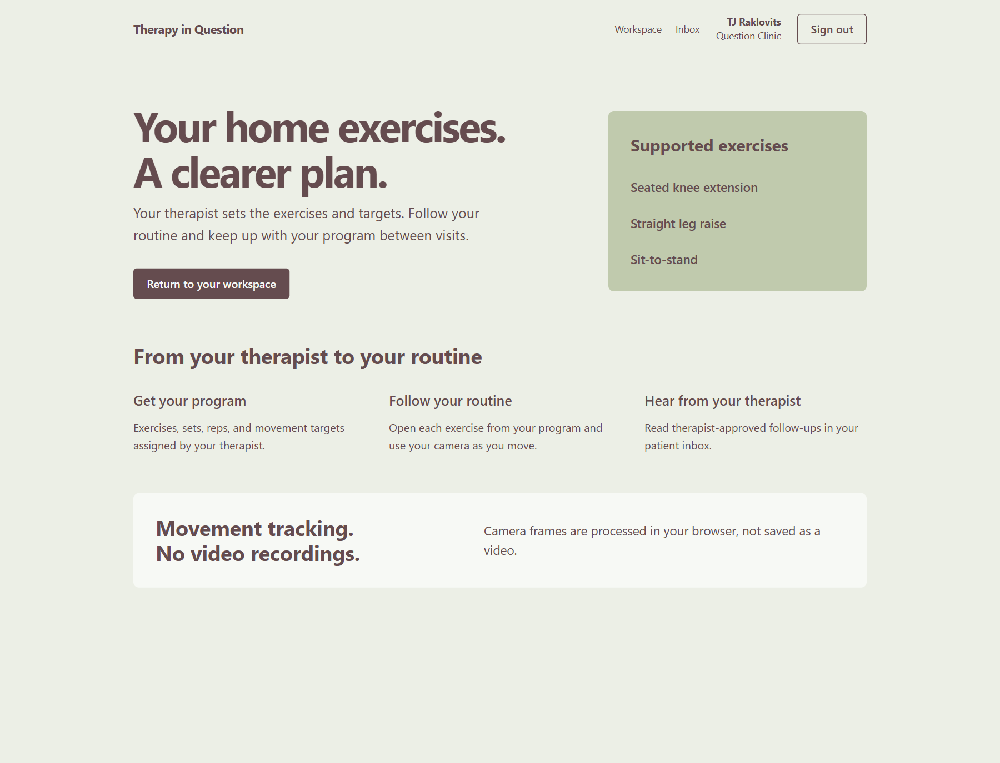
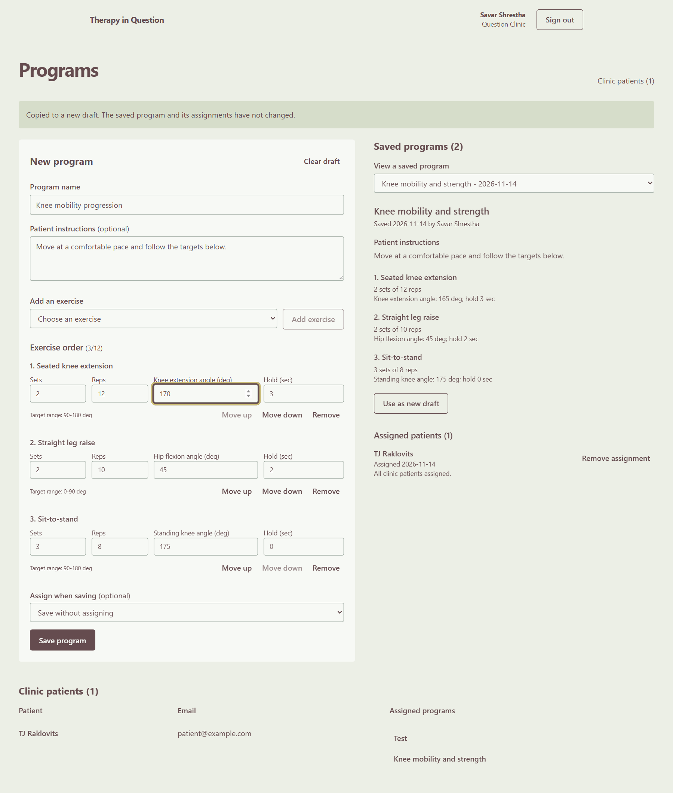
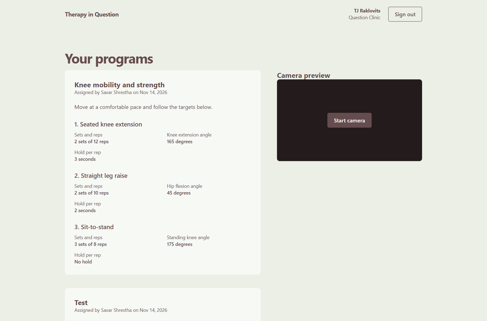
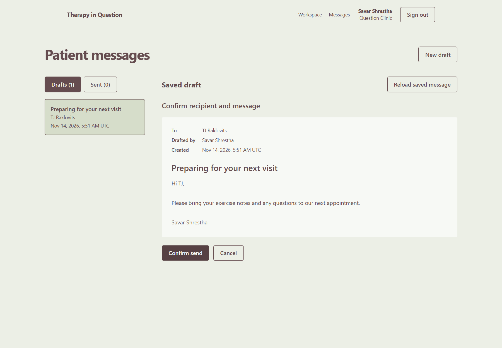
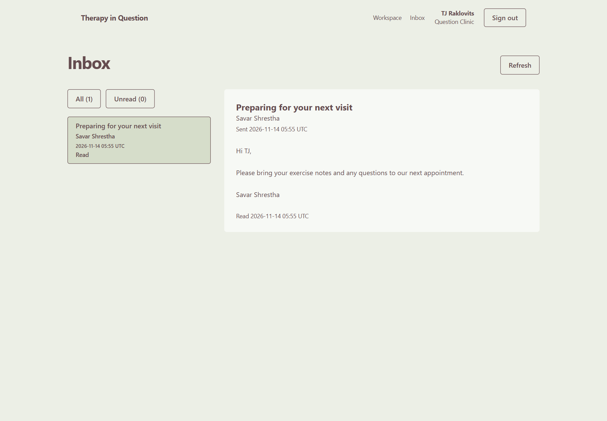

# Therapy-In-Question

A web app for guided physical therapy at home. Therapists build exercise programs and assign them to patients. Patients do the exercises in front of their webcam, and the app tracks their pose in the browser to count reps, measure joint angles, and check their framing. AI-drafted messages go out to patients only after a therapist approves them.


## Screenshots

| | |
|---|---|
|  |  |
|  |  |
|  |  |

## Features

**For patients**
- View assigned programs and start exercise sessions from the browser
- Live pose tracking with automatic rep counting and hold detection
- Joint angle measurement, with rejection of poor-quality readings
- Framing check that blocks the session until the patient is fully in view
- Hands-free controls: raise a hand to pause and resume a session
- Inbox for messages from the therapist

**For therapists**
- Build exercise programs and assign them to patients
- Review and approve messages before they reach patients (drafts come from Gemini)


## Tech stack

| Layer | Technology |
|---|---|
| Frontend | [SvelteKit](https://svelte.dev), TypeScript, Vite, [Bun](https://bun.sh) |
| Pose tracking | Runs client-side in the browser (`frontend/src/lib/pose`) <!-- TODO: name the pose library, e.g. MediaPipe --> |
| Backend | Python 3.14, FastAPI on Uvicorn, [uv](https://docs.astral.sh/uv/) for dependencies |
| Databases | PostgreSQL (TimescaleDB) and MongoDB <!-- TODO: say what each one stores --> |
| AI | Google Gemini |
| Auth | JWT, stored in a cookie |
| Infrastructure | Docker Compose, Traefik reverse proxy, GitHub Actions deploy |

## Architecture

```
Browser ──► Traefik (:80)
              ├── /api/*  ──► backend  (FastAPI, :8000)  ──► PostgreSQL, MongoDB, Gemini
              └── /*      ──► frontend (SvelteKit, :3000) ──► backend (server-side, via API_URL)
```

Traefik routes by path, using labels in `docker-compose.yml`. Requests to `/api` (including WebSockets) go to the backend, and everything else goes to the SvelteKit frontend.

## Getting started

### Prerequisites

- [Docker](https://docs.docker.com/get-docker/) with Docker Compose
- A PostgreSQL database (Timescale Cloud works) and a MongoDB database (Atlas works)
- A [Gemini API key](https://aistudio.google.com/apikey)

### Run with Docker Compose

1. Copy the example environment file:

   ```bash
   cp .env.example .env
   ```

2. Fill in `.env`. See [Configuration](#configuration) below. Generate a JWT secret with:

   ```bash
   openssl rand -hex 32
   ```

3. Start everything:

   ```bash
   docker compose up --build
   ```

4. Open **http://localhost**. Traefik serves the app on port 80, so don't use port 3000.

Camera access works on `localhost`. On any other host, the app must be served over HTTPS or the browser will block the webcam.


### Run without Docker (development)

Run the backend:

```bash
cd backend
uv sync
uv run uvicorn therapy_backend.main:app --reload --port 8000
```

Run the frontend in a second terminal:

```bash
cd frontend
bun install
bun run dev
```

## Configuration

All backend settings come from the root `.env` file.

| Variable | Description |
|---|---|
| `DOMAIN` | Hostname Traefik routes on. Use `localhost` locally. |
| `DATABASE_URL` | PostgreSQL / TimescaleDB connection string. |
| `MONGODB_URI` | MongoDB connection string. |
| `MONGODB_DB` | MongoDB database name (default in the example: `therapy`). |
| `GEMINI_API_KEY` | API key for Gemini. AI features fail without it. |
| `GEMINI_MODEL` | Gemini model name used for message drafting. |
| `JWT_SECRET` | **Required.** Secret used to sign auth tokens. The backend won't start without it. |
| `COOKIE_SECURE` | Set to `true` when serving over HTTPS, `false` for local HTTP. |

Never commit your `.env` file.

The frontend gets `ORIGIN` and `API_URL` from `docker-compose.yml`. You don't need to set them yourself.

## Project structure

```
.
├── frontend/                  SvelteKit app (Bun)
│   └── src/
│       ├── routes/
│       │   ├── +page.svelte           Public landing page
│       │   ├── login/                 Login
│       │   ├── patient/               Patient home, inbox, exercise sessions
│       │   └── therapist/             Therapist dashboard, program builder, message approval
│       ├── lib/
│       │   ├── components/            Webcam, PoseSetup, RepProgress, JointAngles, HandRaiseControls
│       │   ├── pose/                  Pose tracking, geometry, angles, rep counting,
│       │   │                          smoothing (One Euro filter), framing, hand-raise detection
│       │   ├── server/api.ts          Server-side API client
│       │   ├── auth.ts, messages.ts, programs.ts
│       └── hooks.server.ts            Auth/session handling
├── backend/                   FastAPI app (uv)
│   └── src/therapy_backend/
│       ├── main.py                    App entry point and router wiring
│       ├── config.py                  Settings loaded from environment
│       ├── auth.py                    Login and token handling
│       ├── db.py, init.sql            Database access and schema
│       ├── models.py                  Data models
│       ├── programs.py, exercises.py  Programs and exercises
│       ├── messages.py                Patient/therapist messaging
│       ├── gemini.py                  Gemini integration
│       └── seed.py                    Sample data
├── docker-compose.yml         Local stack: backend, frontend, Traefik
├── docker-compose.prod.yml    Production override (HTTPS)
├── .github/workflows/deploy.yml   Deployment workflow
└── .env.example
```

## Deployment

The production stack adds `docker-compose.prod.yml` on top of the base compose file to serve over HTTPS. The `.github/workflows/deploy.yml` workflow handles deployment.


## License

<!-- do we want a license? -->